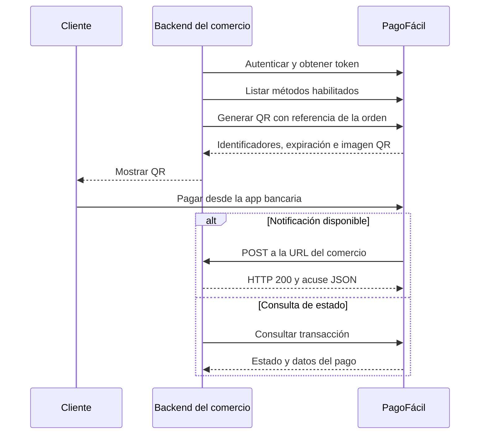

# Integración con PagoFácil QR

Guía técnica basada en **Especificaciones Integración por API — Método QR**, documento **1.1.0** del **2 de julio de 2025**. Los números, identificadores y datos personales de los ejemplos son ilustrativos.

## 1. Configuración y rutas

| Dato | Valor documentado |
| --- | --- |
| Servicio | `PagoFacilServiciosAPI` |
| Versión indicada para el servicio | `1.0.0` |
| URL base HTTPS | `https://masterqr.pagofacil.com.bo/api/services/v2` |
| Credenciales | `tcTokenService` y `tcTokenSecret` |
| Autorización de servicios protegidos | `Authorization: Bearer <accessToken>` |
| Idioma | `Response-Language: es` o `en`. Inglés por defecto. |

| Método y ruta relativa | Propósito | `status` de éxito en el JSON |
| --- | --- | --- |
| `POST /login` | Obtener el token de acceso | `1` |
| `POST /list-enabled-services` | Obtener métodos habilitados y límites | `2006` |
| `POST /generate-qr` | Crear una transacción y obtener el QR | `2007` |
| `POST /query-transaction` | Consultar el estado de una transacción | `2008` |
| `GET /bibliography/{parameterName}` | Consultar definiciones y reglas | `2005` |
| `POST` a la URL del comercio | Recibir la notificación de pago | `1` en el acuse del comercio |

La API usa un objeto JSON con `error`, `status`, `message` y `values`. Los ejemplos exitosos muestran `error: 0`. El campo `status` de nivel superior describe el resultado de la operación y es independiente del código HTTP y de los estados que aparecen dentro de `values`. El encabezado de idioma afecta mensajes y otros textos descriptivos. Usa campos estructurados para tomar decisiones en el código.

## 2. Flujo de cobro

1. El backend del comercio obtiene un token mediante `/login`.
2. Consulta `/list-enabled-services` para seleccionar el método QR y conocer sus límites.
3. Crea una orden local y manda su referencia en `paymentNumber` al invocar `/generate-qr`.
4. Guarda los identificadores devueltos y muestra el QR al cliente. El cliente lo escanea y paga con su aplicación bancaria.
5. PagoFácil envía un callback a la URL indicada. El comercio también puede consultar `/query-transaction` periódicamente.
6. Tras confirmar el pago, el comercio actualiza la orden y notifica al cliente.



## 3. Autenticación

**`POST /login`** · Fuente: p. 5.

Envía las credenciales en las cabeceras. El PDF no muestra un cuerpo para esta operación.

```bash
BASE_URL='https://masterqr.pagofacil.com.bo/api/services/v2'

curl --request POST "$BASE_URL/login" \
  --header "tcTokenService: $PAGOFACIL_TOKEN_SERVICE" \
  --header "tcTokenSecret: $PAGOFACIL_TOKEN_SECRET" \
  --header 'Response-Language: es'
```

```json
{
  "error": 0,
  "status": 1,
  "message": "Autenticación exitosa.",
  "values": {
    "accessToken": "TOKEN_DE_EJEMPLO",
    "tokenType": "bearer",
    "expiresInMinutes": 789.71
  }
}
```

Usa `values.accessToken` como Bearer en las solicitudes siguientes. `expiresInMinutes` puede traer decimales. Calcula el vencimiento al recibirlo y renueva el token antes de ese momento. Los ejemplos siguientes usan `PAGOFACIL_ACCESS_TOKEN` para representar ese valor. Mantén las credenciales y el token en el backend.

## 4. Métodos QR habilitados

**`POST /list-enabled-services`** · Fuente: p. 6.

```bash
curl --request POST "$BASE_URL/list-enabled-services" \
  --header "Authorization: Bearer $PAGOFACIL_ACCESS_TOKEN" \
  --header 'Response-Language: es'
```

```json
{
  "error": 0,
  "status": 2006,
  "message": "Lista de servicios QR habilitados para la compañía recuperada exitosamente.",
  "values": [
    {
      "paymentMethodId": 123,
      "paymentMethodName": "QR de ejemplo",
      "currencyName": "BOB",
      "maxAmountPerDay": 10000.00,
      "maxAmountPerTransaction": 5000.00
    }
  ]
}
```

| Campo | Uso |
| --- | --- |
| `paymentMethodId` | ID que debes enviar como `paymentMethod` al generar el QR. |
| `paymentMethodName` | Nombre del método habilitado. |
| `currencyName` | Código de moneda informado por el método. El ejemplo muestra `BOB`. |
| `maxAmountPerDay` | Límite diario informado para ese método. |
| `maxAmountPerTransaction` | Límite informado por transacción. |

El ID `123` y los montos de ejemplo se reemplazan por los valores devueltos para el comercio.

## 5. Generación del QR

**`POST /generate-qr`** · Fuente: pp. 7–8.

Envía `Authorization: Bearer <accessToken>`, `Content-Type: application/json` y, opcionalmente, `Response-Language: es`. El ejemplo reproduce los nombres de campo de la solicitud del PDF. Consulta la discrepancia sobre el callback en la sección 8.

```json
{
  "paymentMethod": 123,
  "clientName": "Cliente Ejemplo",
  "documentType": 1,
  "documentId": "1234567",
  "phoneNumber": "70000000",
  "email": "cliente@example.com",
  "paymentNumber": "VENTA-000123",
  "amount": 0.10,
  "currency": 2,
  "clientCode": "CLI-000123",
  "callbackUrl": "https://comercio.example.com/api/pagos/pagofacil/callback",
  "orderDetail": [
    {
      "serial": 1,
      "product": "Producto de ejemplo",
      "quantity": 1,
      "price": 0.10,
      "discount": 0,
      "total": 0.10
    }
  ]
}
```

| Campo | Tipo mostrado | Descripción |
| --- | --- | --- |
| `paymentMethod` | Número | ID obtenido de `values[].paymentMethodId`. |
| `clientName` | Texto | Nombre del cliente. |
| `documentType` | Número | Código de tipo de documento. El ejemplo usa `1`. |
| `documentId` | Texto | Número de documento del cliente. |
| `phoneNumber` | Texto | Teléfono del cliente. |
| `email` | Texto | Correo del cliente. |
| `paymentNumber` | Texto | Referencia de la transacción en el comercio. |
| `amount` | Número | Importe de la transacción. |
| `currency` | Número | Código de moneda. El ejemplo usa `2`. |
| `clientCode` | Texto | Identificador del cliente en el comercio. |
| `callbackUrl` | Texto | URL para recibir la notificación, según el ejemplo de generación. |
| `orderDetail` | Lista | Detalle de los ítems. |

Cada ítem del ejemplo contiene `serial` (número de línea), `product` (descripción), `quantity` (cantidad), `price` (precio), `discount` (descuento) y `total` (importe de línea). El PDF presenta un ejemplo de solicitud. La obligatoriedad, longitudes, catálogos y reglas de redondeo quedan por verificar.

### Respuesta de ejemplo

```json
{
  "error": 0,
  "status": 2007,
  "message": "QR Generado Correctamente.",
  "values": {
    "transactionId": "987654",
    "paymentMethodTransactionId": "VENTA-000123",
    "status": 1,
    "expirationDate": "2025-07-02 18:30:00",
    "qrBase64": "BASE64_DE_EJEMPLO",
    "checkoutUrl": "https://example.com/checkout",
    "deepLink": "app://example",
    "qrContentUrl": "https://example.com/qr",
    "universalUrl": "https://example.com/pay"
  }
}
```

| Campo | Uso |
| --- | --- |
| `transactionId` | Identificador asignado por PagoFácil. El ejemplo de generación lo representa como texto. |
| `paymentMethodTransactionId` | Identificador que el PDF describe como referencia de la transacción del comercio. Guárdalo junto con el `paymentNumber` enviado. |
| `values.status` | Estado incluido en la respuesta de generación. El ejemplo muestra `1`, sin un catálogo de significados. |
| `expirationDate` | Fecha y hora de expiración en formato `Y-m-d H:i:s`. La zona horaria queda por confirmar. |
| `qrBase64` | Imagen codificada en Base64. Confirma el tipo MIME antes de construir una URL de datos. |
| `checkoutUrl`, `deepLink`, `qrContentUrl`, `universalUrl` | Enlaces que se devuelven cuando corresponda. Trata estos campos como condicionales. |

El éxito de esta operación confirma la generación del QR. La confirmación del cobro se obtiene en el flujo de consulta o notificación.

## 6. Consulta de transacción

**`POST /query-transaction`** · Fuente: p. 9.

Envía las cabeceras Bearer y JSON. Basta uno de los dos identificadores. Con la referencia del comercio:

```json
{
  "companyTransactionId": "VENTA-000123"
}
```

Con el identificador de PagoFácil:

```json
{
  "pagofacilTransactionId": 987654
}
```

El ejemplo de consulta presenta el ID de PagoFácil sin comillas y el de generación emplea un marcador entre comillas. Confirma el tipo aceptado si eliges consultar con el ID del proveedor.

```json
{
  "error": 0,
  "status": 2008,
  "message": "Consulta realizada.",
  "values": {
    "pagofacilTransactionId": 987654,
    "companyTransactionId": "VENTA-000123",
    "paymentMethodId": 123,
    "paymentStatus": 0,
    "amount": "0.10",
    "currencyId": 2,
    "paymentDate": "2025-07-02 18:15:00",
    "paymentTime": "2025-07-02 18:15:00"
  }
}
```

En este ejemplo, **`paymentStatus: 0` es un marcador ilustrativo sin significado asignado**. El PDF usa un marcador genérico y omite la enumeración de estados. El `status: 2008` indica éxito de la consulta. Usa `values.paymentStatus` con el catálogo confirmado por PagoFácil para identificar un pago. El ejemplo del proveedor representa `amount` como texto decimal y documenta ambos campos temporales con `Y-m-d H:i:s`. Sus valores en estados pendientes quedan por confirmar.

## 7. Bibliografía e idioma

**`GET /bibliography/{parameterName}`** · Fuente: pp. 10–12.

```bash
curl --request GET "$BASE_URL/bibliography/paymentMethod" \
  --header "Authorization: Bearer $PAGOFACIL_ACCESS_TOKEN" \
  --header 'Response-Language: es'
```

`parameterName` identifica un parámetro o método documentado, como `paymentMethod` o `generateQr`. Al encontrarlo, el servicio devuelve `error: 0`, `status: 2005` y un objeto `values` que puede contener:

| Campo | Contenido |
| --- | --- |
| `parameter` | Nombre del parámetro o método. |
| `description` | Descripción. |
| `usage` | Propósito y uso. |
| `rules` | Reglas de uso en un objeto JSON. |
| `requirements` | Lista de requisitos. |
| `example` | Ejemplo de URL y explicación de la respuesta. |

La cobertura de esta función está en desarrollo. Envía `Response-Language: es` para español o `Response-Language: en` para inglés. Si omites la cabecera, el inglés es el idioma predeterminado.

## 8. Notificación de pago por callback

Fuente: p. 12. PagoFácil envía un `POST` con un objeto JSON a la URL del comercio. Conserva las mayúsculas de los nombres de campo.

| Campo | Descripción |
| --- | --- |
| `PedidoID` | Identificador del pedido, número de venta o factura del comercio. Úsalo para localizar la orden. |
| `Fecha` | Fecha de realización del pago. |
| `Hora` | Hora del pago. |
| `MetodoPago` | Medio usado para pagar. |
| `Estado` | Estado informado por la notificación. |

### Solicitud entrante de ejemplo

```json
{
  "PedidoID": "VENTA-000123",
  "Fecha": "<fecha del pago>",
  "Hora": "<hora del pago>",
  "MetodoPago": "<medio de pago>",
  "Estado": "<estado informado>"
}
```

Los textos entre ángulos representan datos por confirmar con una notificación real de prueba. El PDF no define formatos concretos de `Fecha` y `Hora` ni el catálogo de `Estado`.

### Acuse esperado por PagoFácil

Responde con **HTTP `200 OK`** y un cuerpo JSON con esta estructura:

```json
{
  "error": 0,
  "status": 1,
  "message": "Notificación recibida",
  "values": true
}
```

**Nombre del campo de registro.** La solicitud de `/generate-qr` muestra `callbackUrl` y la sección de notificaciones lo llama `tcUrlCallBack`. Confirma cuál acepta el servicio antes de integrar esa parte del flujo. El documento tampoco especifica firma, autenticación, política de reintentos ni el plazo de respuesta del callback.

## 9. Integración en el backend del comercio

Las siguientes pautas son decisiones de implementación para el comercio.

1. **Crear y guardar una referencia local.** Persiste el ID de la orden, `paymentNumber`, monto y moneda antes de solicitar el QR. Guarda los IDs y la fecha de expiración devueltos. Usa aritmética decimal para comparar montos.
2. **Recibir y conciliar.** Usa `PedidoID` para localizar la orden y consulta `/query-transaction` desde el backend como verificación hasta contar con un mecanismo de autenticación del callback confirmado por el proveedor. Comprueba referencia, monto, moneda y estado antes de acreditar el pago.
3. **Actualizar sin duplicar efectos.** Aplica una transición atómica a pagado cuando la validación sea correcta. Si una consulta y un callback llegan a la vez, o se repite la notificación, la acreditación y la actualización de la orden deben ocurrir una sola vez.
4. **Conciliar errores de red.** Si una llamada a `/generate-qr` termina con un timeout, consulta por la referencia local antes de volver a generar. La idempotencia de generación y el comportamiento ante referencias repetidas quedan por confirmar.
5. **Probar el ciclo completo.** Valida el login y su renovación, el QR de un método habilitado, un pago de prueba, la correspondencia de `PedidoID` y `paymentNumber`, el acuse del callback, la consulta manual y una notificación duplicada.

## 10. Puntos para confirmar con PagoFácil

| Tema | Detalle pendiente |
| --- | --- |
| Credenciales y ambientes | URL y credenciales de pruebas, si están disponibles, y condiciones de paso a producción. |
| Catálogos | Valores válidos para `documentType`, `currency`, `paymentStatus` y `Estado`. |
| Generación | Campos obligatorios, formatos, precisión monetaria, tipo MIME del QR y tratamiento de referencias duplicadas. |
| Consulta | Tipo de `pagofacilTransactionId`, nulos o campos omitidos antes del pago y frecuencia de consulta permitida. |
| Fechas | Zona horaria, tiempo de vigencia del QR y formatos efectivos del callback. |
| Callback | Campo aceptado al generar, autenticación, reintentos y comportamiento al recibir errores o agotar el tiempo de respuesta. |
| Errores | Mapeo de códigos HTTP, `error` y `status` para fallos de API. |

## 11. Soporte técnico

- Correo: [atencion.cliente@pagofacil.com.bo](mailto:atencion.cliente@pagofacil.com.bo)
- Celular: **(+591) 75353593**
- El PDF también menciona el grupo designado para coordinar credenciales y consultas técnicas.
